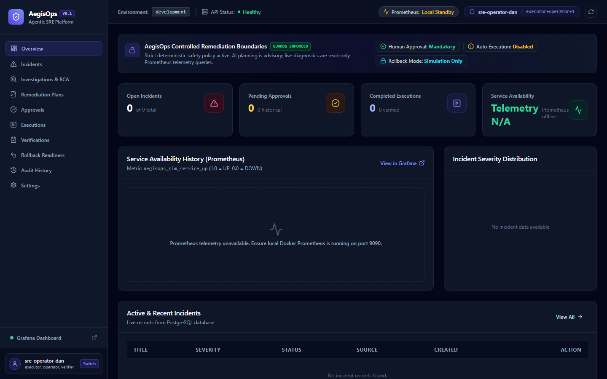
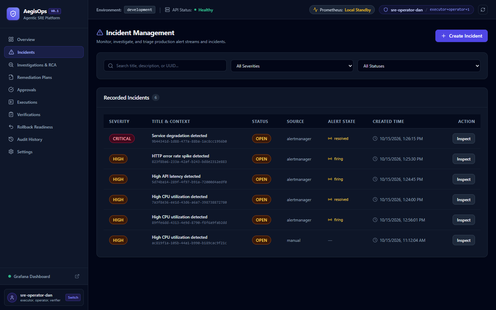
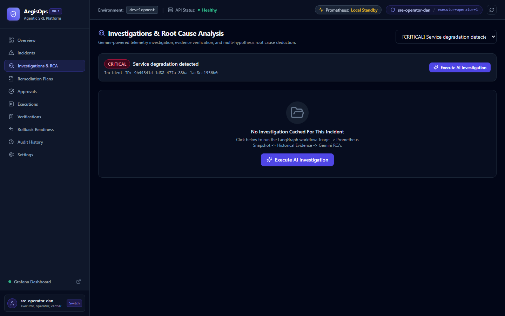
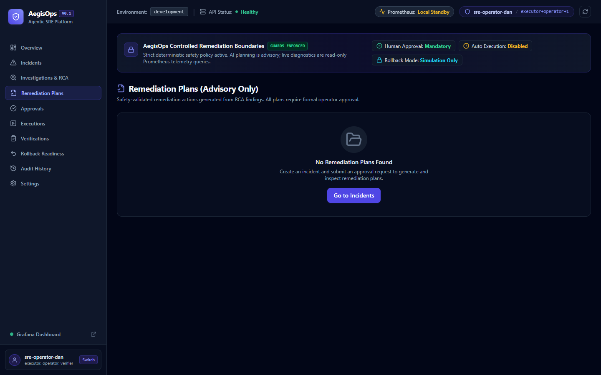
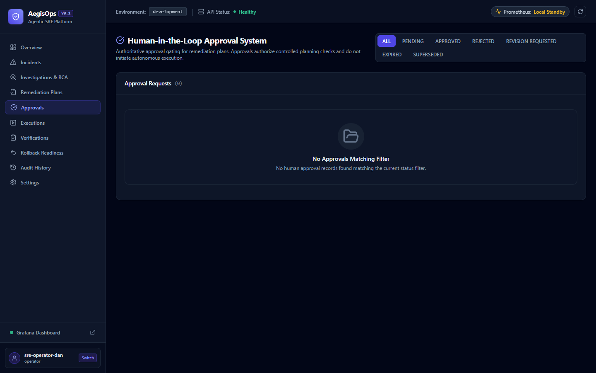
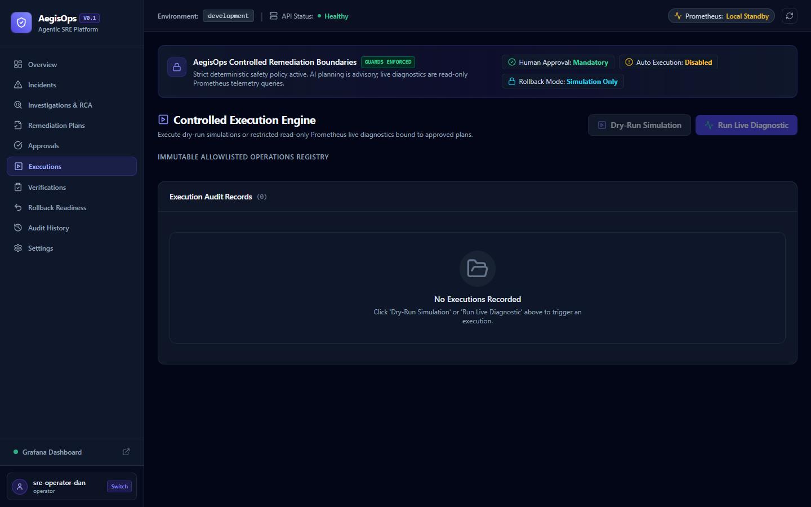
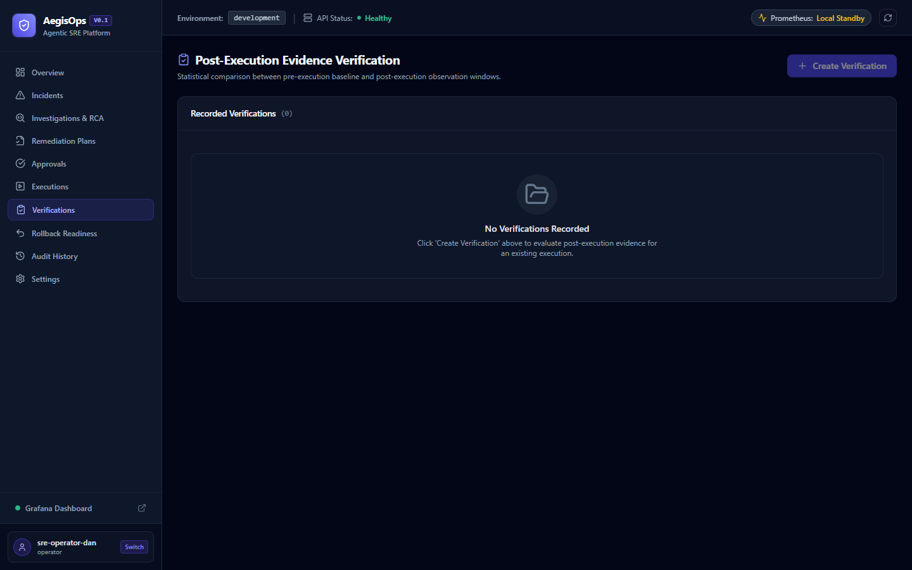
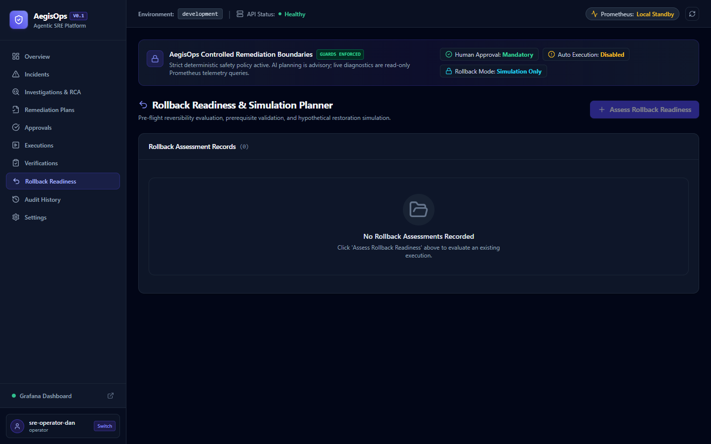
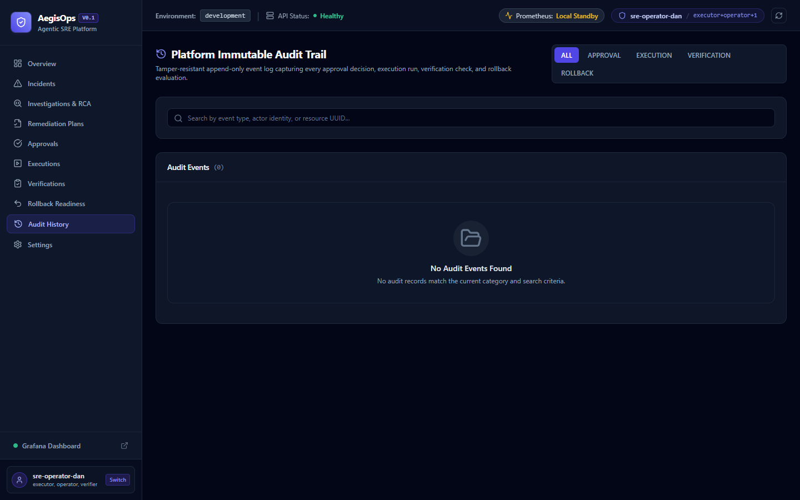
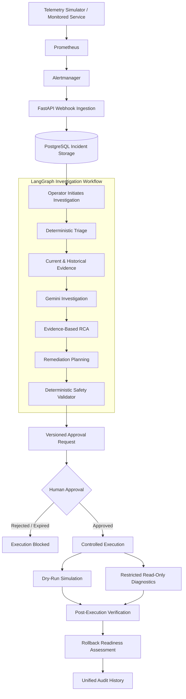

# AegisOps
### Agentic SRE & Autonomous Incident Response Platform


**AegisOps** is an Agentic AI-powered Site Reliability Engineering (SRE) platform that connects infrastructure monitoring with intelligent incident investigation and controlled response workflows.

It integrates Prometheus, Alertmanager, LangGraph, Google Gemini, and FastAPI to detect incidents, collect monitoring evidence, generate root-cause hypotheses, recommend remediation steps, and manage human-approved diagnostic operations.

The platform is designed around one principle:

**AI investigates and recommends. Deterministic safety controls and authorized humans govern execution.**

> **Project scope:** AegisOps supports advisory remediation plans, safe execution simulations, and restricted read-only Prometheus diagnostics. It does not perform autonomous infrastructure mutations or actual rollback execution.

---

## Application Preview



The operator dashboard provides incident statistics, live service availability, severity distribution, monitoring connectivity, and access to the complete incident-response workflow.

### Additional Screenshots

| Incident Management | AI Investigation & RCA |
|:---:|:---:|
|  |  |

| Remediation Planning | Human Approval Gateway |
|:---:|:---:|
|  |  |

| Controlled Execution | Post-Execution Verification |
|:---:|:---:|
|  |  |

| Rollback Readiness | Audit History |
|:---:|:---:|
|  |  |

---

## 1. Why AegisOps?

Modern applications generate continuous monitoring data. When something fails, engineers often have to switch between multiple tools to understand what happened, investigate possible causes, decide on recovery steps, and document their actions.

This creates several challenges:

- **Fragmented incident context:** Alerts, metrics, investigation findings, and operational decisions are spread across different tools.
- **Slow investigation:** Engineers manually correlate current and historical telemetry.
- **Unsafe AI automation:** Unrestricted AI-generated commands can introduce additional operational risks.
- **Limited accountability:** Incident decisions and diagnostic activities may lack a consistent audit trail.

AegisOps addresses these problems through a unified, evidence-driven incident-response workflow.

It combines monitoring, multi-stage agentic reasoning, deterministic safety validation, human authorization, controlled diagnostics, post-execution verification, and audit history in one application.

---

## 2. Key Features

| Feature | Description |
|---|---|
| Automated Incident Ingestion | Receives authenticated Alertmanager webhooks and deduplicates incoming incidents. |
| Intelligent Triage | Classifies incident priority using deterministic rules. |
| Agentic Investigation | Uses LangGraph and Gemini to investigate monitoring anomalies. |
| Evidence-Based RCA | Generates root-cause hypotheses with supporting, contradicting, and missing evidence. |
| Remediation Planning | Produces structured advisory recommendations and validation steps. |
| Safety Validation | Enforces deterministic restrictions independently of LLM-generated content. |
| Human Approval Gateway | Provides versioned approval requests, SHA-256 plan integrity, and separation of duties. |
| Controlled Execution | Supports safe simulations and approved read-only Prometheus diagnostics. |
| Post-Execution Verification | Compares monitoring evidence across baseline and follow-up windows. |
| Rollback Readiness | Evaluates hypothetical restoration requirements without changing infrastructure. |
| Unified Audit History | Records approval decisions, execution events, verification results, and rollback assessments. |
| Operator Dashboard | Provides a React-based interface for the complete operational lifecycle. |

---

## 3. System Architecture

AegisOps separates observability, agentic reasoning, safety enforcement, and execution into distinct layers.



The React frontend provides a unified interface for reviewing incidents, initiating workflows, managing approvals, inspecting execution records, and accessing verification results.

PostgreSQL stores incidents and related operational records. Prometheus, Alertmanager, and Grafana provide monitoring and observability capabilities.

For more implementation details, see [Architecture Documentation](docs/architecture.md).

---

## 4. How the Agentic Workflow Works

AegisOps uses LangGraph to orchestrate specialized investigation stages instead of relying on a single unrestricted LLM prompt.

The workflow begins when an authorized operator explicitly initiates an incident analysis.

| Stage | Responsibility |
|---|---|
| Triage | Determines incident priority and escalation requirements. |
| Evidence Collection | Retrieves current Prometheus metric snapshots. |
| Historical Evidence | Collects monitoring samples from a relevant time window. |
| Investigation | Uses Gemini to evaluate anomalies and recommend diagnostic checks. |
| Root Cause Analysis | Generates possible explanations and evaluates the available evidence. |
| Remediation Planning | Creates structured, advisory recommendations. |
| Safety Validation | Applies deterministic Python rules to the generated plan. |

### Evidence-grounded reasoning

The RCA stage distinguishes three important categories:

- **Supporting evidence:** Observations consistent with a proposed root cause.
- **Contradicting evidence:** Observations that weaken a hypothesis.
- **Missing evidence:** Information needed before reaching a stronger conclusion.

AI-generated hypotheses are not automatically treated as confirmed root causes.

### Why deterministic safety validation matters

Gemini provides reasoning and recommendations, but it does not control the platform's execution permissions.

Safety constraints are enforced separately in Python, including:

- Human approval requirements.
- Disabled autonomous execution.
- Allowlisted diagnostic operations.
- Risk and plan-integrity validation.
- Restrictions against arbitrary shell execution and infrastructure mutation.

This separation keeps AI reasoning outside the final authorization boundary.

---

## 5. Monitoring and Alerting

The local development environment includes a telemetry simulator and a complete observability stack.

### Monitoring components

| Component | Responsibility |
|---|---|
| Telemetry Simulator | Generates reproducible service-health scenarios. |
| Prometheus | Scrapes metrics and evaluates alerting rules. |
| Alertmanager | Routes alert notifications to the FastAPI webhook. |
| Grafana | Visualizes platform and service telemetry. |
| FastAPI | Authenticates incoming webhook requests and creates or updates incidents. |

### Supported simulation scenarios

The evaluation fixtures include:

- Healthy service.
- High CPU utilization.
- High latency.
- Error-rate spike.
- Service degradation.

The simulator exposes metrics representing availability, CPU usage, latency, and error rate.

When an alert is triggered, Alertmanager sends a notification to AegisOps. The backend processes the alert and stores the associated incident.

**AI analysis does not automatically run for every ingested alert.** An authorized operator initiates the investigation from the frontend.

---

## 6. Human Approval and Execution Safety

AegisOps uses a human-in-the-loop approval system to prevent an AI-generated recommendation from becoming an unrestricted operational action.

### Approval lifecycle

1. An investigation produces a safety-validated remediation plan.
2. An authorized requester submits the plan for approval.
3. AegisOps creates an immutable, versioned snapshot.
4. A SHA-256 hash binds the approval to the plan contents.
5. A separate authorized approver reviews the request.
6. The approver may approve, reject, or request revisions.
7. Only an eligible approved plan can proceed to controlled execution.

Approval expiration, plan integrity, authorization, and separation-of-duties rules are enforced by the backend.

### Supported execution modes

| Mode | Description | Infrastructure changes |
|---|---|---|
| Dry-Run Simulation | Produces a controlled synthetic execution result. | None |
| Live Diagnostic | Performs an allowlisted read-only Prometheus query. | None |
| Autonomous Remediation | Not implemented. | Not supported |
| Actual Rollback | Not implemented. | Not supported |

Live diagnostics are disabled by default and require additional authorization and configuration.

The platform does not provide arbitrary SSH, shell, Kubernetes mutation, container termination, or cloud infrastructure modification capabilities.

---

## 7. Frontend Operator Console

AegisOps provides a React and TypeScript interface covering the incident lifecycle.

The application includes 11 routes.

| Page | Purpose |
|---|---|
| Overview | Displays service health, incidents, approvals, and recent activity. |
| Incidents | Search, filter, create, and inspect incidents. |
| Incident Details | Review incident context and its linked investigation, plan, and operational records. |
| Investigations & RCA | Examine telemetry, AI findings, and root-cause hypotheses. |
| Remediation Plans | Review recommended actions, risk levels, and plan integrity. |
| Approvals | Manage human approval decisions and inspect approval history. |
| Executions | Run authorized simulations and inspect diagnostic records. |
| Verifications | Compare baseline and follow-up monitoring evidence. |
| Rollback Readiness | Evaluate restoration prerequisites and applicability. |
| Audit History | Inspect recorded operational decisions and events. |
| Settings | View monitoring connectivity, system boundaries, and operator permissions. |

The development environment also provides a persona switcher for demonstrating role-based workflows.

See the [Complete Frontend Reference](docs/AEGISOPS_COMPLETE_FRONTEND_REFERENCE.md) for a detailed explanation of individual pages, buttons, forms, and operational actions.

---

## 8. Technology Stack

| Layer | Technologies |
|---|---|
| Backend | Python 3.12, FastAPI, Pydantic, Uvicorn |
| Agentic AI | LangGraph, Google Gemini |
| Database | PostgreSQL 17, SQLAlchemy Async, asyncpg, Alembic |
| Monitoring | Prometheus, Alertmanager, Grafana |
| Frontend | React 18, TypeScript, Vite, Tailwind CSS |
| Frontend Libraries | TanStack Query, React Router, React Hook Form, Zod, Recharts |
| Deployment | Docker, Docker Compose, Nginx |
| Backend Testing | Pytest, Ruff, Pyright |
| Frontend Testing | Vitest, ESLint, TypeScript |
| Dependency Management | uv, npm |

The configured Gemini model is `gemini-3.5-flash-lite`.

Detailed dependency information is available in [Technology Stack](docs/technology_stack.md).

---

## 9. Getting Started

The following instructions are intended for Windows CMD.

### Prerequisites

Install:

- Python 3.12.
- [uv](https://docs.astral.sh/uv/).
- Node.js 20 or newer and npm.
- Docker Desktop with Docker Compose v2.
- Git.

Ensure Docker Desktop is running before starting AegisOps.

### Step 1 — Clone the repository

```cmd
git clone <YOUR_GITHUB_REPOSITORY_URL>
cd <YOUR_CLONED_PROJECT_DIRECTORY>
```

Replace the placeholders with the actual repository URL and directory.

### Step 2 — Configure environment variables

Create the local environment file:

```cmd
copy .env.example .env
```

Open it:

```cmd
notepad .env
```

Configure the required local credentials and application settings.

Use unique credentials. Do not commit populated environment files.

The development Docker Compose setup also requires:

`infrastructure/.env`

The development lifecycle manager checks and prepares the required configuration using the project's existing setup.

Consult [Development Workflow](docs/development_workflow.md) for complete configuration instructions.

### Step 3 — Install dependencies

From the project root:

```cmd
uv sync --python 3.12
```

Install frontend dependencies:

```cmd
cd frontend
npm ci
cd ..
```

### Step 4 — Start the application

AegisOps includes a unified lifecycle manager to avoid manually launching duplicate backend or simulator processes.

Run:

```cmd
uv run python scripts/dev.py check
uv run python scripts/dev.py start
```

Check the operational status:

```cmd
uv run python scripts/dev.py status
```

The startup workflow manages Docker infrastructure, database migrations, the telemetry simulator, FastAPI, and the React development server.

Running the start command again reuses existing healthy development services.

### Step 5 — Open the application

| Service | Local URL |
|---|---|
| AegisOps Frontend | http://localhost:5173 |
| FastAPI Documentation | http://localhost:8000/docs |
| Prometheus | http://localhost:9090 |
| Grafana | http://localhost:3000 |
| Alertmanager | http://localhost:9093 |

Grafana uses the administrator credentials configured in your local environment.

### Additional development commands

Diagnose startup problems:

```cmd
uv run python scripts/dev.py doctor
```

Check component status:

```cmd
uv run python scripts/dev.py status
```

Stop lifecycle-managed development processes safely:

```cmd
uv run python scripts/dev.py stop
```

These commands preserve PostgreSQL data and Docker volumes.

---

## 10. Production-Like Docker Deployment

AegisOps includes a separate, single-server, production-like Docker Compose deployment.

It is intended for controlled deployment testing and portfolio demonstrations. It is **not a claim of unrestricted public-production readiness**.

### Deployment architecture

The isolated stack contains:

- Nginx frontend and reverse proxy.
- FastAPI backend.
- PostgreSQL.
- Prometheus.
- Alertmanager.
- Grafana.
- Database migration service.

PostgreSQL and the backend are not directly published to the host.

### Local deployment ports

| Service | URL |
|---|---|
| Frontend | http://localhost:8080 |
| Prometheus | http://localhost:9091 |
| Grafana | http://localhost:3001 |
| Alertmanager | http://localhost:9094 |

### Start the isolated deployment

Configure the required secrets in:

`infrastructure/deployment/.env`

Then execute:

```cmd
docker compose --env-file infrastructure/deployment/.env -p aegisops-prod -f infrastructure/deployment/compose.yaml up -d --build
```

Verify the deployment:

```cmd
uv run python scripts/verify_deployment.py
```

For setup requirements, security considerations, migration behaviour, and recovery procedures, see [Deployment Guide](docs/deployment.md).

> Public internet deployment requires additional infrastructure and security hardening, including an appropriate identity provider, HTTPS, and environment-specific security review.

---

## 11. Testing and Evaluation

AegisOps includes backend regression tests, frontend tests, and a dedicated platform evaluation framework.

### Backend tests

```cmd
uv run ruff check src tests scripts migrations evaluation
uv run ruff format --check src tests scripts migrations evaluation
uv run pytest -q
npx pyright src evaluation
```

### Frontend tests

```cmd
cd frontend
npm run lint
npm run typecheck
npm run test -- --run
npm run build
```

### Platform evaluation

From the repository root:

```cmd
uv run python scripts/evaluate_platform.py --suite all --mode mocked
```

This runs deterministic evaluations without requiring paid Gemini API calls.

### Reported validation results

| Validation | Last reported result |
|---|---|
| Backend regression | 245 passed |
| Frontend tests | 15 passed |
| Platform evaluation | 7/7 mocked suites passed |
| Ruff and Pyright | Passed |
| Frontend TypeScript/build | Passed |
| Browser inspection | All 11 routes inspected |

The evaluation suite covers agent quality, safety boundaries, authorization, incident workflows, reliability, performance, and cost modelling.

**Evaluation results are based on the project's documented test scenarios and mocked evaluation mode. They are not production reliability benchmarks or proof of error-free operation.**

See [Evaluation Documentation](docs/evaluation.md) for methodology, limitations, and detailed results.

---

## 12. Security and Operational Boundaries

AegisOps implements multiple layers of protection:

- Backend-enforced role-based access control.
- Development persona switching restricted by environment.
- Session authentication and CSRF protection.
- Separation of duties for plan approvals.
- Versioned approval snapshots and SHA-256 integrity verification.
- Allowlisted execution operations.
- Restricted read-only live diagnostics.
- No arbitrary infrastructure-changing commands.
- Secret redaction in structured logging.
- Local deployment port isolation.
- Recorded approval, execution, verification, and assessment events.

The application is designed to **fail closed** when authorization, plan integrity, eligibility, or execution safety checks are not satisfied.

See [Security Documentation](docs/security.md).

---

## 13. Backup and Recovery

The project includes database backup and verification utilities.

Create a logical backup:

```cmd
uv run python scripts/backup_db.py --container aegisops-prod-postgres --output-dir backups
```

The backup utility creates an SQL dump and a companion SHA-256 checksum.

Verify backup integrity using the backup file's actual path:

```cmd
uv run python scripts/backup_db.py --verify-only <BACKUP_FILE_PATH>
```

Validate restoration without overwriting the database:

```cmd
uv run python scripts/restore_db.py --dry-run <BACKUP_FILE_PATH>
```

Actual restoration requires an additional explicit overwrite confirmation.

The documented validation covered backup verification and dry-run restoration; a destructive full restoration is not claimed.

See [Backup and Recovery Guide](docs/backup_recovery.md).

---

## 14. Current Limitations

AegisOps is a portfolio-grade engineering project with intentionally restricted operational capabilities.

| Limitation | Current behaviour |
|---|---|
| Real infrastructure repair | Not implemented; remediation plans are advisory. |
| Autonomous execution | Disabled by design. |
| Live diagnostics | Restricted to approved, read-only Prometheus operations. |
| Rollback execution | Not implemented; readiness assessment only. |
| Development monitoring | Uses reproducible synthetic service scenarios. |
| Deployment architecture | Single-server, production-like Docker Compose setup. |
| Public identity integration | Requires further deployment-specific integration and hardening. |

### Potential Future Improvements

- OpenTelemetry distributed trace correlation.
- Kubernetes read-only diagnostics.
- Advanced incident similarity and historical retrieval.
- Multi-service and multi-region monitoring.
- Automated post-incident report and runbook generation.
- External identity-provider integration.

---

## 15. Documentation

Additional technical references are available in the `docs/` directory.

| Document | Contents |
|---|---|
| [Architecture](docs/architecture.md) | System design and component interactions |
| [Development Workflow](docs/development_workflow.md) | Local startup, shutdown, and troubleshooting |
| [Complete Frontend Reference](docs/AEGISOPS_COMPLETE_FRONTEND_REFERENCE.md) | Pages, features, buttons, and usage |
| [Technology Stack](docs/technology_stack.md) | Technology selection and dependencies |
| [Evaluation](docs/evaluation.md) | Testing methodology and results |
| [Deployment](docs/deployment.md) | Production-like Docker deployment |
| [Security](docs/security.md) | Authentication, authorization, and safety boundaries |
| [Observability](docs/observability.md) | Prometheus, Alertmanager, and Grafana |
| [Backup & Recovery](docs/backup_recovery.md) | Database backup and restoration procedures |
| [Portfolio Summary](docs/portfolio_summary.md) | Project presentation and interview reference |

---

### Project Summary

**AegisOps demonstrates how Agentic AI can support real-world SRE workflows without granting an LLM unrestricted control over operational infrastructure.**

It combines evidence-based investigation, specialized LangGraph agents, deterministic safety enforcement, human authorization, controlled diagnostics, verification, and operational auditability into one integrated platform.