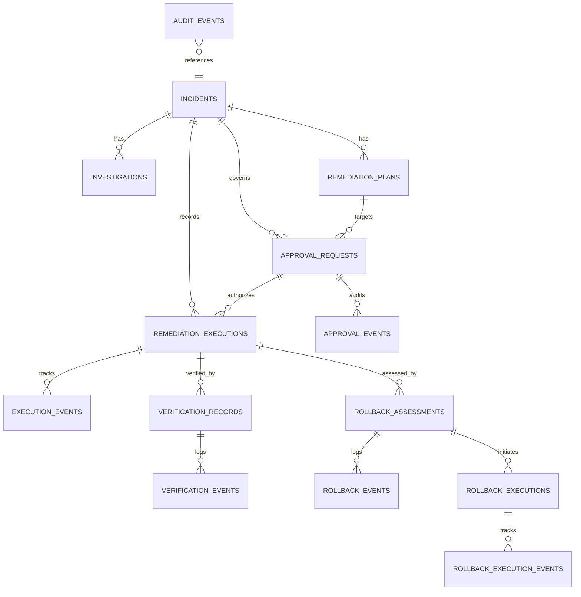

# AegisOps — API & Database Reference

**Agentic SRE & Autonomous Incident Response Platform**  
*Complete REST API Specification, Schemas, Database Architecture & Alembic Lifecycle*

---

## 1. REST API Specification

All endpoints are versioned under `/api/v1` and served over HTTP/HTTPS by FastAPI.

### 1.1 Authentication & Personas

| Endpoint | Method | Required Role | Request Body | Response Model | Description |
|---|---|---|---|---|---|
| `/auth/login` | `POST` | Public | `LoginRequest` (username, password) | `TokenResponse` (access_token, token_type, expires_in) | Authenticates user credentials and returns JWT bearer token. |
| `/auth/me` | `GET` | Authenticated | None | `UserResponse` (identity, roles, can_approve, can_execute, etc.) | Returns profile, active persona, and capability permissions of caller. |
| `/auth/switch-persona/{persona}` | `POST` | Dev Only | None | `TokenResponse` | Switches active development persona and returns a signed bearer token. Disabled in production. |

---

### 1.2 Incidents & Alertmanager Ingestion

| Endpoint | Method | Required Role | Request Body | Response Model | Description |
|---|---|---|---|---|---|
| `/incidents` | `GET` | Any | Query params: `status`, `severity`, `limit`, `offset` | `List[IncidentSummaryResponse]` | Paginated list of incidents sorted by recency and severity. |
| `/incidents/{id}` | `GET` | Any | None | `IncidentDetailResponse` | Detailed incident record including timeline, labels, and linked plans. |
| `/incidents` | `POST` | `sre_operator`, `sre_lead` | `CreateIncidentRequest` (title, description, severity, status, source) | `IncidentDetailResponse` | Manually registers an incident in the platform. |
| `/incidents/{id}/status` | `PATCH` | `sre_operator`, `sre_lead` | `UpdateIncidentStatusRequest` (status: firing/investigating/mitigated/resolved) | `IncidentDetailResponse` | Updates incident status lifecycle. |
| `/webhooks/alertmanager` | `POST` | Public / Webhook | Alertmanager JSON payload | `WebhookResponse` (status, ingested_count) | Ingests firing/resolved alerts directly from Prometheus Alertmanager. |

---

### 1.3 AI Investigation & Root Cause Analysis

| Endpoint | Method | Required Role | Request Body | Response Model | Description |
|---|---|---|---|---|---|
| `/investigations` | `POST` | `sre_operator`, `sre_lead` | `CreateInvestigationRequest` (incident_id, mode: "gemini"\|"deterministic", override_telemetry?) | `InvestigationDetailResponse` | Triggers LangGraph multi-stage investigation and generates remediation recommendations. |
| `/investigations/{id}` | `GET` | Any | None | `InvestigationDetailResponse` | Fetches investigation outcome, root cause hypothesis, confidence score, and telemetry matrix. |
| `/incidents/{incident_id}/remediation-plans` | `GET` | Any | None | `List[RemediationPlanResponse]` | Lists all versioned remediation plans generated for a specific incident. |

---

### 1.4 Human-in-the-Loop Approval Governance

| Endpoint | Method | Required Role | Request Body | Response Model | Description |
|---|---|---|---|---|---|
| `/incidents/{id}/approvals` | `POST` | `sre_operator`, `sre_lead` | `CreateApprovalRequest` (incident_id, requested_by) | `ApprovalDetailResponse` | Initiates formal approval request for the latest active remediation plan. |
| `/approvals` | `GET` | Any | Query params: `status`, `limit`, `offset` | `List[ApprovalSummaryResponse]` | Lists approval requests filtered by status (`pending`, `approved`, `rejected`, `cancelled`). |
| `/approvals/{id}` | `GET` | Any | None | `ApprovalDetailResponse` | Detailed approval request, bound plan hash, and review decision trail. |
| `/approvals/{id}/approve` | `POST` | `sre_lead`, `incident_commander` | `ApprovalDecisionRequest` (reason, notes) | `ApprovalDetailResponse` | Approves remediation plan. **Enforces separation of duties** (`actor != requested_by`). |
| `/approvals/{id}/reject` | `POST` | `sre_lead`, `incident_commander` | `ApprovalDecisionRequest` (reason, notes) | `ApprovalDetailResponse` | Rejects remediation plan with mandatory rationale. |
| `/approvals/{id}/events` | `GET` | Any | None | `List[ApprovalEventResponse]` | Audit trail of all state transitions and review decisions for an approval. |

---

### 1.5 Controlled Execution Engine

| Endpoint | Method | Required Role | Request Body | Response Model | Description |
|---|---|---|---|---|---|
| `/execution-operations` | `GET` | Any | None | `List[OperationDefinitionResponse]` | Returns immutable allowlisted operations registry (5 diagnostic operations). |
| `/execution-operations/demo` | `GET` | Any | None | `List[OperationDefinitionResponse]` | Returns demo remediation operations registry (3 simulator operations). |
| `/executions` | `GET` | Any | Query params: `mode`, `status`, `limit`, `offset` | `List[ExecutionSummaryResponse]` | Audit list of all executions. |
| `/executions/{id}` | `GET` | Any | None | `ExecutionDetailResponse` | Full execution record including telemetry output, duration, and audit events. |
| `/executions/simulate` | `POST` | `sre_operator`, `sre_lead` | `ExecuteSimulationRequest` (approval_id, incident_id, operation_id, recommendation_index, idempotency_key, parameters) | `ExecutionDetailResponse` | Executes synthetic dry-run simulation of approved remediation action. |
| `/executions/diagnose` | `POST` | `sre_operator`, `sre_lead` | `ExecuteDiagnosticRequest` (approval_id, incident_id, operation_id, recommendation_index, idempotency_key, parameters) | `ExecutionDetailResponse` | Executes read-only Prometheus telemetry probe bound to approved plan. |
| `/executions/execute-demo` | `POST` | `sre_operator`, `sre_lead` | `ExecuteDemoRequest` (approval_id, incident_id, operation_id, recommendation_index, idempotency_key, parameters) | `ExecutionDetailResponse` | Executes allowlisted remediation action against isolated demo simulator (port 8001). |
| `/executions/{id}/events` | `GET` | Any | None | `List[ExecutionEventResponse]` | Chronological audit trail of execution lifecycle events. |

---

### 1.6 Post-Execution Telemetry Verification

| Endpoint | Method | Required Role | Request Body | Response Model | Description |
|---|---|---|---|---|---|
| `/executions/{id}/verifications` | `POST` | `sre_operator`, `sre_lead` | `CreateVerificationRequest` (idempotency_key, window_minutes?) | `VerificationDetailResponse` | Initiates automated Prometheus telemetry verification comparing pre vs post metrics. |
| `/verifications` | `GET` | Any | Query params: `status`, `outcome`, `limit`, `offset` | `List[VerificationSummaryResponse]` | Lists all post-execution verification assessments. |
| `/verifications/{id}` | `GET` | Any | None | `VerificationDetailResponse` | Detailed verification metrics, statistical change ratio, and sufficiency ratings. |
| `/verifications/{id}/events` | `GET` | Any | None | `List[VerificationEventResponse]` | Audit trail of verification progression. |

---

### 1.7 Rollback Readiness & Restoration Engine

| Endpoint | Method | Required Role | Request Body | Response Model | Description |
|---|---|---|---|---|---|
| `/executions/{id}/rollback-assessments` | `POST` | `sre_operator`, `sre_lead` | `CreateRollbackAssessmentRequest` (idempotency_key) | `RollbackAssessmentDetailResponse` | Evaluates hypothetical reversibility, validates prerequisites, and formulates simulation. |
| `/rollback-assessments` | `GET` | Any | Query params: `readiness_status`, `applicability`, `limit` | `List[RollbackAssessmentSummaryResponse]` | Lists pre-flight rollback assessments. |
| `/rollback-assessments/{id}` | `GET` | Any | None | `RollbackAssessmentDetailResponse` | Detailed rollback prerequisites, readiness status, and simulated target state. |
| `/demo-rollbacks/execute` | `POST` | `sre_operator`, `sre_lead` | `ExecuteRollbackRequest` (assessment_id, idempotency_key, reason) | `RollbackExecutionDetailResponse` | Restores pre-incident snapshot scenario on isolated demo simulator. |
| `/rollback-executions` | `GET` | Any | Query params: `limit`, `offset` | `List[RollbackExecutionDetailResponse]` | Audit history of demo rollback executions. |
| `/rollback-executions/{id}` | `GET` | Any | None | `RollbackExecutionDetailResponse` | Detailed rollback execution record including restored scenario and state diff. |

---

### 1.8 Audit Trail & System Configuration

| Endpoint | Method | Required Role | Request Body | Response Model | Description |
|---|---|---|---|---|---|
| `/audit/events` | `GET` | Any | Query params: `actor`, `action`, `limit`, `offset` | `List[AuditEventResponse]` | System-wide immutable security audit log. |
| `/settings` | `GET` | Any | None | `SystemSettingsResponse` | Exposes non-sensitive feature flags (live diagnostics, demo execution enabled, environment). |
| `/overview/stats` | `GET` | Any | None | `OverviewStatsResponse` | Aggregate metrics for Overview dashboard (MTTR, open incidents, approval counts). |

---

## 2. Database Schema & Architecture

The database is built on **PostgreSQL 16** with strict relational integrity, UUID primary keys, and database-level `CHECK` constraints to enforce safety invariants.

### 2.1 Entity-Relationship Diagram



---

### 2.2 Table Specifications

#### 1. `incidents`
- `id`: UUID (Primary Key, default `gen_random_uuid()`)
- `title`: VARCHAR(255), Not Null
- `description`: TEXT
- `severity`: VARCHAR(32) — Constraint: `severity IN ('critical', 'high', 'medium', 'low', 'info')`
- `status`: VARCHAR(32) — Constraint: `status IN ('firing', 'investigating', 'identified', 'mitigated', 'resolved', 'escalated')`
- `source`: VARCHAR(64) — e.g. `prometheus_alertmanager`, `manual`, `sre_console`
- `labels`: JSONB (key-value labels from Prometheus)
- `created_at`, `updated_at`: TIMESTAMPTZ

#### 2. `investigations`
- `id`: UUID (Primary Key)
- `incident_id`: UUID (Foreign Key -> `incidents.id` ON DELETE CASCADE)
- `status`: VARCHAR(32) — `pending`, `running`, `completed`, `failed`
- `mode`: VARCHAR(32) — `gemini`, `deterministic`
- `hypotheses`: JSONB (ranked candidate root causes)
- `root_cause_analysis`: JSONB (chosen root cause, confidence score, evidence matrix)
- `telemetry_summary`: JSONB (Prometheus metric excerpts)
- `duration_ms`: INTEGER
- `started_at`, `completed_at`: TIMESTAMPTZ

#### 3. `remediation_plans`
- `id`: UUID (Primary Key)
- `incident_id`: UUID (Foreign Key -> `incidents.id`)
- `version`: INTEGER (1-based sequence per incident)
- `plan_hash`: VARCHAR(64) (Cryptographic SHA-256 hash of entire recommendation payload)
- `recommendations`: JSONB (ordered array of ranked remediation actions)
- `status`: VARCHAR(32) — `draft`, `submitted`, `approved`, `superseded`
- `created_at`: TIMESTAMPTZ

#### 4. `approval_requests`
- `id`: UUID (Primary Key)
- `incident_id`: UUID (Foreign Key -> `incidents.id`)
- `plan_id`: UUID (Foreign Key -> `remediation_plans.id`)
- `plan_hash`: VARCHAR(64) (Matches `remediation_plans.plan_hash` exactly)
- `status`: VARCHAR(32) — Constraint: `status IN ('pending', 'approved', 'rejected', 'cancelled')`
- `requested_by`: VARCHAR(128) (Identity of requester, e.g. `sre-operator-dan`)
- `approved_by`: VARCHAR(128) (Identity of approver, e.g. `sre-lead-rachel`)
- `decision_reason`: TEXT
- `requested_at`, `decided_at`: TIMESTAMPTZ

#### 5. `approval_events`
- `id`: UUID (Primary Key)
- `approval_id`: UUID (Foreign Key -> `approval_requests.id` ON DELETE CASCADE)
- `actor`: VARCHAR(128)
- `event_type`: VARCHAR(64) — `approval_requested`, `approval_granted`, `approval_rejected`, `approval_cancelled`
- `previous_status`, `new_status`: VARCHAR(32)
- `details`: JSONB
- `created_at`: TIMESTAMPTZ

#### 6. `remediation_executions`
- `id`: UUID (Primary Key)
- `incident_id`: UUID (Foreign Key -> `incidents.id`)
- `approval_id`: UUID (Foreign Key -> `approval_requests.id`)
- `operation_id`: VARCHAR(128) (Must exist in allowlisted operation registry)
- `recommendation_index`: INTEGER (1-based index)
- `mode`: VARCHAR(32) — Constraint: `mode IN ('simulation', 'live_diagnostic', 'demo_execution')`
- `status`: VARCHAR(32) — Constraint: `status IN ('pending', 'running', 'simulated', 'diagnosed', 'executed', 'failed', 'rejected', 'timed_out')`
- `idempotency_key`: VARCHAR(128) (Unique constraint to prevent double-execution)
- `system_changes_performed`: BOOLEAN (True for demo executions against simulator)
- `parameters`: JSONB (Validated operation parameters)
- `simulation_result`: JSONB (Null if not simulation)
- `diagnostic_result`: JSONB (Null if not live diagnostic)
- `execution_result`: JSONB (Simulator mutation result and restored metrics)
- `duration_ms`: INTEGER
- `requested_by`: VARCHAR(128)
- `started_at`, `completed_at`: TIMESTAMPTZ

#### 7. `execution_events`
- `id`: UUID (Primary Key)
- `execution_id`: UUID (Foreign Key -> `remediation_executions.id` ON DELETE CASCADE)
- `actor`: VARCHAR(128)
- `event_type`: VARCHAR(64) — `execution_started`, `execution_completed`, `execution_failed`, `diagnostic_completed`, `simulation_completed`
- `previous_status`, `new_status`: VARCHAR(32)
- `details`: JSONB
- `created_at`: TIMESTAMPTZ

#### 8. `verification_records`
- `id`: UUID (Primary Key)
- `execution_id`: UUID (Foreign Key -> `remediation_executions.id`)
- `incident_id`: UUID (Foreign Key -> `incidents.id`)
- `status`: VARCHAR(32) — `pending`, `running`, `completed`, `failed`
- `outcome`: VARCHAR(64) — `healthy_confirmed`, `degradation_persists`, `diagnostic_verified`, `inconclusive`
- `baseline_telemetry`: JSONB (Prometheus metrics before execution)
- `followup_telemetry`: JSONB (Prometheus metrics after execution)
- `statistical_comparison`: JSONB (absolute/relative change, observed direction)
- `remediation_success_confirmed`: BOOLEAN
- `human_review_required`: BOOLEAN
- `duration_ms`: INTEGER
- `started_at`, `completed_at`: TIMESTAMPTZ

#### 9. `rollback_assessments`
- `id`: UUID (Primary Key)
- `execution_id`: UUID (Foreign Key -> `remediation_executions.id`)
- `incident_id`: UUID (Foreign Key -> `incidents.id`)
- `readiness_status`: VARCHAR(32) — `ready`, `blocked`, `not_applicable`, `failed`
- `applicability`: VARCHAR(32) — `not_applicable`, `applicable`
- `risk_level`: VARCHAR(32) — `low`, `medium`, `high`
- `rollback_execution_enabled`: BOOLEAN
- `human_authorization_required`: BOOLEAN (Always TRUE)
- `system_changes_performed`: BOOLEAN
- `simulation_result`: JSONB (Restoration plan simulation)
- `assessment_data`: JSONB (Safety prerequisite evaluation)
- `requested_by`: VARCHAR(128)
- `requested_at`, `completed_at`: TIMESTAMPTZ

#### 10. `rollback_executions`
- `id`: UUID (Primary Key)
- `assessment_id`: UUID (Foreign Key -> `rollback_assessments.id`)
- `execution_id`: UUID (Foreign Key -> `remediation_executions.id`)
- `incident_id`: UUID (Foreign Key -> `incidents.id`)
- `status`: VARCHAR(32) — `pending`, `running`, `executed`, `failed`
- `restored_scenario`: VARCHAR(64) (e.g. `high_cpu`)
- `restored_state`: JSONB (Snapshot state restored to simulator)
- `duration_ms`: INTEGER
- `requested_by`: VARCHAR(128)
- `idempotency_key`: VARCHAR(128) (Unique)
- `started_at`, `completed_at`: TIMESTAMPTZ

#### 11. `rollback_execution_events`
- `id`: UUID (Primary Key)
- `rollback_execution_id`: UUID (Foreign Key -> `rollback_executions.id` ON DELETE CASCADE)
- `actor`: VARCHAR(128)
- `event_type`: VARCHAR(64) — `rollback_started`, `rollback_completed`, `rollback_failed`
- `details`: JSONB
- `created_at`: TIMESTAMPTZ

#### 12. `audit_events`
- `id`: UUID (Primary Key)
- `actor`: VARCHAR(128), Not Null
- `action`: VARCHAR(128), Not Null
- `target_type`: VARCHAR(64), Not Null
- `target_id`: VARCHAR(128)
- `details`: JSONB
- `ip_address`: VARCHAR(45)
- `created_at`: TIMESTAMPTZ (Immutable append-only timestamp)

---

## 3. Alembic Database Migrations

AegisOps uses Alembic to manage database schema evolutions strictly under revision control.

### 3.1 Migration History

| Revision ID | Description | Key Changes |
|---|---|---|
| `e06c1164aeef` | Initial schema | Created `incidents`, `investigations`, `remediation_plans`, `approval_requests`, `remediation_executions`, `verification_records`, `rollback_assessments`, `audit_events`. |
| `a4b1c2d3e4f5` | Safety invariant hardening | Added database-level `CHECK` constraints on status, mode, and separation of duties. |
| `b7e8d9c0a1f2` | Verification telemetry expansions | Added statistical comparison fields and temporal coverage tracking. |
| `3d8f1e9b2c4a` | Enable demo execution & rollback | Allowed `mode='demo_execution'`, `status='executed'`, added `execution_result` JSONB column, created `rollback_executions` and `rollback_execution_events` tables. |

### 3.2 Running Migrations via CLI

```cmd
:: Activate virtual environment
call .venv\Scripts\activate.bat

:: Check current revision
python -m alembic current

:: Upgrade to head
python -m alembic upgrade head

:: View revision history
python -m alembic history --verbose
```
