# AegisOps — Platform Architecture & System Design

## 1. Architecture Overview

**AegisOps** is an autonomous incident response and agentic Site Reliability Engineering (SRE) platform. It integrates synthetic/real-time telemetry monitoring, automated alert ingestion, multi-agent AI investigation and root-cause analysis (RCA), deterministic safety validation, human-in-the-loop approval gating, and simulation-only/read-only diagnostic execution.

The platform is designed around a fundamental principle: **AI agents propose, assist, and analyze; humans decide and authorize; execution boundaries remain deterministic, immutable, and strictly non-destructive.**

---

## 2. End-to-End System Architecture

```mermaid
flowchart TD
    subgraph TELEMETRY["1. Observability & Telemetry Ingestion"]
        SIM["Telemetry Simulator<br/>(scripts/simulate_service.py)"]
        PROM["Prometheus v3.5.0<br/>(Metrics Scraper & Rules Engine)"]
        AM["Alertmanager v0.28.1<br/>(Deduplication & Webhook Dispatch)"]
        GRAF["Grafana v12.1.1<br/>(Operator Dashboards)"]

        SIM -->|Exposes /metrics| PROM
        PROM -->|Fires Alerts| AM
        PROM -.->|Visualized by| GRAF
    end

    subgraph INGESTION["2. Gateway & Ingestion Layer"]
        AM -->|Signed Webhook<br/>Bearer Token Auth| NGINX["Nginx Reverse Proxy<br/>(Port 8080)"]
        NGINX -->|Reverse Proxy /api/| API["FastAPI Backend Service<br/>(Port 8000)"]
        REACT["React 18 + Vite SPA<br/>(Operator Dashboard)"] -->|User Requests| NGINX
    end

    subgraph PERSISTENCE["3. Persistent Storage & State"]
        PG[("PostgreSQL 17 Database<br/>(Isolated Named Volume)")]
        API <-->|SQLAlchemy 2.0 Async| PG
    end

    subgraph AGENTIC["4. LangGraph Agentic Incident Workflow"]
        TRIAGE["Triage Agent<br/>(Deterministic Severity Mapping)"]
        EVID["Evidence Collector<br/>(Real-time Prometheus Telemetry)"]
        HIST["Historical Evidence Collector<br/>(Time-windowed Metric Analysis)"]
        GEM_INV["Gemini Investigation Agent<br/>(Telemetry Grounding & Anomaly Analysis)"]
        GEM_RCA["Gemini RCA Agent<br/>(Evidence-grounded Hypotheses)"]
        REM_PLAN["Remediation Planner<br/>(Safe Advisory Step Generation)"]
        SAFETY["Deterministic Safety Validator<br/>(AST / Command Pattern / Leak Filter)"]

        API -->|Trigger Pipeline| TRIAGE
        TRIAGE --> EVID
        EVID --> HIST
        HIST --> GEM_INV
        GEM_INV --> GEM_RCA
        GEM_RCA --> REM_PLAN
        REM_PLAN --> SAFETY
    end

    subgraph HUMAN_GATEWAY["5. Human Approval Gateway & Governance"]
        APP_REQ["Immutable Approval Request<br/>(Plan SHA-256 Hash Locked)"]
        HUMAN["Human SRE Operator / Lead<br/>(Role-Based Access Control)"]
        DECISION{"Dual-Control Decision<br/>Requester != Approver"}

        SAFETY --> APP_REQ
        APP_REQ -.->|Awaits Decision| HUMAN
        HUMAN -->|Approve / Reject / Revise| DECISION
    end

    subgraph EXECUTION["6. Controlled Execution & Safety Boundaries"]
        DECISION -->|Rejected / Expired| CLOSED["Fail Closed (No-Op)"]
        DECISION -->|Approved + Valid Hash| EXEC_GATE["Execution Dispatcher"]

        EXEC_GATE --> SIM_EXEC["Simulation Mode<br/>(Dry-run Telemetry Evaluation)"]
        EXEC_GATE --> READONLY_DIAG["Restricted Live Diagnostics<br/>(Allowlisted Read-Only PromQL)"]

        subgraph FORBIDDEN["Strictly Prohibited & Physically Blocked"]
            NO_SHELL["Arbitrary Shell Execution (BLOCKED)"]
            NO_K8S["Autonomous K8s Mutation (BLOCKED)"]
            NO_SSH["Remote SSH State Changes (BLOCKED)"]
            NO_ROLL["Live Infrastructure Rollback (BLOCKED)"]
        end
    end

    subgraph VERIFY_ROLLBACK["7. Post-Execution & Governance Audit"]
        SIM_EXEC --> POST_VERIF["Post-Execution Verification<br/>(Deterministic Metric Comparison)"]
        READONLY_DIAG --> POST_VERIF
        POST_VERIF --> ROLL_ASSESS["Rollback Readiness Assessment<br/>(Deterministic Baseline Evaluation)"]
        ROLL_ASSESS --> AUDIT[("Append-Only Audit Log<br/>(Cryptographic Hashes & Actors)")]
        AUDIT --> PG
    end

    style FORBIDDEN fill:#4a1515,stroke:#ff4d4d,stroke-width:2px,color:#fff
    style SAFETY fill:#1e3a1e,stroke:#4caf50,stroke-width:2px
    style HUMAN_GATEWAY fill:#1e2a3a,stroke:#2196f3,stroke-width:2px
    style AGENTIC fill:#252538,stroke:#9c27b0,stroke-width:2px
```

---

## 3. Core Architectural Subsystems

### A. Observability & Telemetry Ingestion Pipeline
1. **Telemetry Simulator**: Simulates microservice behavior across 5 operational scenarios (`healthy`, `high_cpu`, `high_latency`, `error_spike`, `service_degradation`).
2. **Prometheus**: Scrapes target metrics at 5-second intervals, evaluating alert rules for threshold violations.
3. **Alertmanager**: Deduplicates active firing alerts and dispatches cryptographically authenticated webhook notifications to the AegisOps backend.
4. **Grafana**: Visualizes golden signals, incident rates, agent lifecycle duration, and safety validation statuses.

### B. Agentic Workflow (LangGraph & Google Gemini)
1. **Triage Agent**: Deterministically normalizes incoming alert severities (P1–P4) and maps them to priority states.
2. **Real-Time & Historical Evidence Collectors**: Queries Prometheus metrics over structured temporal windows (e.g., T-15m to T+0) with strict NaN/Infinity handling and zero-value preservation.
3. **Gemini Investigation Agent**: Analyzes gathered telemetry without fabricating observations. Strictly cites provided metric values.
4. **Gemini Evidence-Backed RCA Agent**: Generates structured hypotheses categorized by confidence. Never marks root cause as unconditionally confirmed (`root_cause_confirmed = False`).
5. **Remediation Planner**: Formulates non-destructive, advisory recommendations (log inspection, config review, diagnostic query).
6. **Deterministic Safety Validator**: Evaluates every generated recommendation against a strict command allowlist and regex blocklist, ensuring zero state-mutating commands or adversarial prompts pass.

### C. Human Approval Gateway & RBAC
1. **Immutable Approval Records**: Every plan snapshot is SHA-256 hashed and persisted to PostgreSQL. Any tampering invalidates the hash.
2. **Dual-Control Enforcement**: The human operator who requested an approval cannot approve their own request (`requester != approver`).
3. **Time-Bound TTL**: Approvals expire after 24 hours. Expired approvals fail closed.

### D. Controlled Execution Safeguards
1. **Simulation Mode**: Operators can run plans in dry-run simulation mode without external network I/O or system mutation.
2. **Restricted Live Diagnostics**: When explicitly enabled by configuration, only server-allowlisted read-only diagnostics (e.g., specific PromQL metric inspections) may execute.
3. **Non-Destructive Invariant**: AegisOps includes no autonomous shell execution, SSH mutation, or Kubernetes modifying credentials.

### E. Post-Execution Verification & Rollback Assessment
1. **Verification**: Compares pre-execution baseline metrics against post-execution follow-up telemetry to evaluate if degradation persisted.
2. **Rollback Assessment**: Deterministically evaluates rollback feasibility. For read-only operations, safely reports `Readiness: Not Applicable`. Actual infrastructure rollback execution is strictly disabled.
3. **Audit Logging**: Every transition, actor decision, and execution event is committed to an append-only audit trail in PostgreSQL.

---

## 4. Network Topology & Deployment Architecture

```mermaid
graph LR
    subgraph HOST["Host Operating System (Windows / Linux)"]
        BROWSER["Operator Web Browser<br/>(Chrome / Edge)"]
    end

    subgraph DOCKER["Docker Engine (Isolated Project: aegisops-prod)"]
        subgraph PUBLISHED["Exposed Ports (Loopback 127.0.0.1 Only)"]
            NGINX_PORT["Port 8080 (HTTP)"]
            PROM_PORT["Port 9091 (HTTP)"]
            GRAF_PORT["Port 3001 (HTTP)"]
            AM_PORT["Port 9094 (HTTP)"]
        end

        subgraph BRIDGE["Isolated Bridge Network (aegisops-prod-net)"]
            NGINX_SVC["aegisops-prod-frontend<br/>(Nginx 1.27-alpine)"]
            BACKEND_SVC["aegisops-prod-backend<br/>(FastAPI / Uvicorn)"]
            PG_SVC["aegisops-prod-postgres<br/>(PostgreSQL 17-alpine)"]
            PROM_SVC["aegisops-prod-prometheus<br/>(Prometheus v3.5.0)"]
            GRAF_SVC["aegisops-prod-grafana<br/>(Grafana v12.1.1)"]
            AM_SVC["aegisops-prod-alertmanager<br/>(Alertmanager v0.28.1)"]
        end

        subgraph VOLUMES["Named Persistent Volumes"]
            PG_VOL[("aegisops_prod_postgres_data")]
            PROM_VOL[("aegisops_prod_prometheus_data")]
            GRAF_VOL[("aegisops_prod_grafana_data")]
        end
    end

    BROWSER -->|127.0.0.1:8080| NGINX_PORT
    BROWSER -->|127.0.0.1:9091| PROM_PORT
    BROWSER -->|127.0.0.1:3001| GRAF_PORT
    BROWSER -->|127.0.0.1:9094| AM_PORT

    NGINX_PORT --> NGINX_SVC
    NGINX_SVC -->|Reverse Proxy /api/| BACKEND_SVC
    BACKEND_SVC -->|Internal Port 5432| PG_SVC
    BACKEND_SVC -->|Internal Telemetry Queries| PROM_SVC
    AM_SVC -->|Internal Webhook POST| BACKEND_SVC

    PG_SVC --- PG_VOL
    PROM_SVC --- PROM_VOL
    GRAF_SVC --- GRAF_VOL

    style PG_SVC fill:#1e3a1e,stroke:#4caf50
    style BACKEND_SVC fill:#1e2a3a,stroke:#2196f3
    style NGINX_SVC fill:#252538,stroke:#9c27b0
```

---

## 5. Security & Boundary Principles

| Domain | Architectural Rule | Enforcement Mechanism |
|---|---|---|
| **Database Port** | Zero host exposure for production PostgreSQL | Docker Compose port omitted; internal bridge only |
| **Authentication** | Bearer tokens mapped to personas with strict RBAC | FastAPI dependency injection & SHA-256 token validation |
| **CSRF Protection** | Session-bound double-submit cryptographic token | FastAPI middleware validating `X-CSRF-Token` against session |
| **Dual Control** | Requesters cannot approve their own remediation requests | Approval service validates `approver != requester` |
| **Plan Integrity** | Stored plan content cannot be tampered with | SHA-256 plan hash verified before execution |
| **Execution Boundary** | Zero arbitrary command execution | Hardcoded read-only operation registry |
| **Rollback Boundary** | Live automated rollback disabled | Deterministic assessment returns `not_applicable` for simulations |
| **AI Grounding** | Gemini cannot assert ungrounded root causes | Prompt instructions & schema require `root_cause_confirmed = False` |
