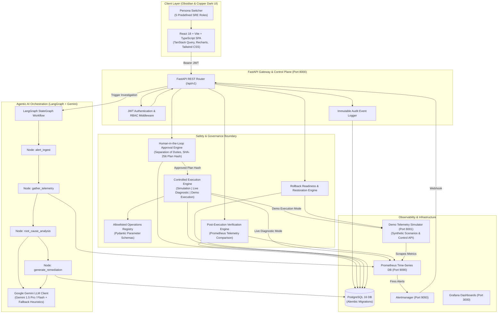
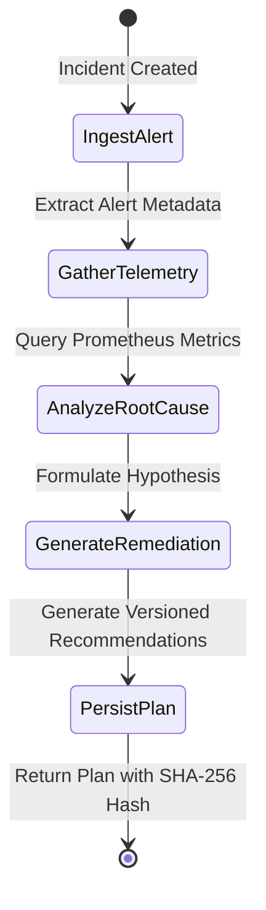

# AegisOps — Architecture & Technical Guide

**Agentic SRE & Autonomous Incident Response Platform**  
*Comprehensive System Reference, Architecture Blueprint, and Technical Runbook*

---

## 1. System Overview & Business Context

### 1.1 Executive Summary
Modern enterprise distributed systems run thousands of microservices generating millions of telemetry events every second. When critical incidents occur, Site Reliability Engineering (SRE) teams face severe cognitive overload: alert storms, fragmented metrics, complex distributed tracing, and slow manual root-cause investigations. 

**AegisOps** is an enterprise-grade Agentic SRE and Autonomous Incident Response Platform built to compress Mean Time to Detect (MTTD) and Mean Time to Remediate (MTTR) from hours down to seconds while maintaining **deterministic safety invariants** and **mandatory human-in-the-loop governance**.

Unlike naive autonomous systems that execute hallucinated shell commands or opaque scripts in production, AegisOps adheres to a strict zero-trust safety doctrine:
1. **Advisory AI Planning:** AI models (Google Gemini via LangGraph) generate root-cause hypotheses and remediation plans with SHA-256 cryptographic versioning.
2. **Mandatory Human-in-the-Loop Approval:** No remediation can execute without explicit cryptographic approval by an authorized SRE lead.
3. **Strict Separation of Duties:** An engineer who requests an approval cannot approve their own request (HTTP 403 Forbidden).
4. **Deterministic Allowlisted Operations:** Execution is strictly limited to pre-registered, schema-validated operations with zero shell interpolation.
5. **Post-Execution Verification:** Automated statistical telemetry verification validates whether system health actually recovered following remediation.
6. **Controlled Sandbox & Rollback:** Demo remediation execution and stateful rollback are safely performed against isolated demo services, while production environments (`is_production == True`) remain completely protected against unauthorized mutations.

---

## 2. Architectural Blueprint & System Topology

### 2.1 High-Level Architecture Diagram



---

## 3. Agentic AI & LangGraph Investigation Engine

### 3.1 LangGraph StateGraph Architecture
The investigation engine uses **LangGraph** to model incident analysis as a stateful, cyclic directed graph. The shared state is defined by the `InvestigationState` TypedDict:

```python
class InvestigationState(TypedDict):
    incident_id: str
    incident_title: str
    incident_description: str
    severity: str
    service_name: str
    telemetry_window_minutes: int
    raw_telemetry: Dict[str, Any]
    telemetry_summary: Dict[str, Any]
    hypotheses: List[Dict[str, Any]]
    root_cause_analysis: Dict[str, Any]
    remediation_recommendations: List[Dict[str, Any]]
    error: Optional[str]
    mode: str  # "gemini" or "deterministic"
```

### 3.2 Graph Nodes & Transitions



1. **`ingest_alert`**: Parses incident labels, severity, timestamp, and affected service name.
2. **`gather_telemetry`**: Queries Prometheus range queries over the pre-incident and active-incident time window (CPU utilization, p99 latency, error rate, memory saturation).
3. **`analyze_root_cause`**:
   - Calls Google Gemini with a structured prompt containing Prometheus telemetry matrices and service topology.
   - Evaluates competing hypotheses: e.g., thread pool exhaustion vs. database connection saturation vs. memory leak.
   - Computes confidence scores and risk impact.
   - If the Gemini API key is unset or network calls fail, seamlessly falls back to a deterministic rule-based expert heuristic system to guarantee zero operational outage.
4. **`generate_remediation`**:
   - Formulates 1 to 3 ranked remediation actions.
   - Synthesizes action parameters, estimated recovery time, and reversibility rating.
   - Computes a cryptographic SHA-256 hash of the complete plan payload to bind subsequent approval requests immutably to this exact recommendation version.

---

## 4. Deep Dive into Core Subsystems

### 4.1 Telemetry Simulator (`scripts/simulate_service.py`)
Provides realistic, isolated service telemetry on port 8001:
- **Exposed Prometheus Metrics:**
  - `http_requests_total{service="api-service", status="200|500"}`
  - `http_request_duration_seconds{service="api-service", quantile="0.99"}`
  - `container_cpu_usage_seconds_total{container="api-service"}`
  - `service_up{service="api-service"}`
- **Synthetic Scenarios:**
  - `healthy`: CPU 25%, Latency 80ms, Error Rate 0.1%, Up 1.0.
  - `high_cpu`: CPU 95%, Latency 2.4s, Error Rate 8.0%, Up 1.0.
  - `memory_leak`: CPU 85%, Memory 98%, Latency 4.2s, Up 1.0.
  - `downstream_failure`: CPU 45%, Latency 6.5s, Error Rate 42.0%, Up 1.0.
  - `service_outage`: CPU 0%, Latency 0s, Error Rate 100%, Up 0.0.
- **REST Control Endpoints:**
  - `GET /control/state`: Real-time scenario, metrics, auto-cycle status, and snapshot state.
  - `POST /control/scenario/{name}`: Forces immediate scenario switch.
  - `POST /control/auto_cycle`: Toggles autonomous 45-second scenario transitions.
  - `POST /control/remediate`: Snapshots the active degraded state, forces healthy telemetry baselines, and halts auto-cycling.
  - `POST /control/rollback`: Restores snapshot degraded state to verify post-rollback behavior.

### 4.2 Prometheus & Alerting Rules (`infrastructure/prometheus/`)
- Prometheus scrapes the simulator every 5 seconds.
- Alert rules detect:
  - `HighCPUUsage`: CPU > 85% for 30s.
  - `HighErrorRate`: 5xx errors > 5% for 30s.
  - `HighLatency`: p99 latency > 1.5s for 30s.
  - `ServiceDown`: `service_up == 0` for 15s.
- Alerts are dispatched to Alertmanager, which posts to `http://aegisops-backend:8000/api/v1/webhooks/alertmanager`.

---

## 5. Complete Lifecycle State Machines

### 5.1 Incident Lifecycle
```
[FIRING / OPEN] ──> [INVESTIGATING] ──> [IDENTIFIED] ──> [MITIGATED] ──> [RESOLVED]
                           │
                           └──> [ESCALATED]
```

### 5.2 Approval Lifecycle
```
[PENDING] ──(Approved by Lead)──> [APPROVED] ──(Dispatched to Execution)
    │
    ├──(Rejected by Lead)────────> [REJECTED]
    └──(Plan superseded/expired)─> [CANCELLED]
```
- **Strict Separation of Duties:** If `actor == requested_by`, the approval endpoint aborts with HTTP 403 Forbidden: *"Separation of duties violation: An engineer cannot approve their own remediation request."*

### 5.3 Execution Lifecycle
```
[PENDING] ──> [RUNNING] ──┬──(Simulation Mode)────> [SIMULATED]
                          ├──(Live Diagnostic)───> [DIAGNOSED]
                          ├──(Demo Remediation)───> [EXECUTED]
                          └──(Failure/Timeout)────> [FAILED]
```

### 5.4 Rollback Readiness & Execution Lifecycle
```
[EVALUATE EXECUTION]
         │
         ├── Read-Only Live Diagnostic ──> [NOT_APPLICABLE] (Zero mutations occurred)
         ├── Simulation Mode ───────────> [NOT_APPLICABLE] (Dry-run only)
         └── Demo Remediation Executed ──> [APPLICABLE] ──> [READY_FOR_REVIEW]
                                                                    │
                                                           [EXECUTE ROLLBACK]
                                                                    │
                                                                    ▼
                                                            [RESTORED] (Snapshot reverted)
```

---

## 6. Observability & Telemetry Infrastructure

| Component | Port | Purpose | Health Check |
|---|---|---|---|
| **FastAPI Backend** | `8000` | REST API, Agentic AI, Execution, Approvals | `GET http://127.0.0.1:8000/health` |
| **Telemetry Simulator**| `8001` | Synthetic Microservice & REST Control API | `GET http://127.0.0.1:8001/health` |
| **Prometheus** | `9090` | Time-Series Metrics Ingestion & Alert Evaluation | `GET http://127.0.0.1:9090/-/healthy` |
| **Alertmanager** | `9093` | Alert Grouping, Deduplication & Webhooks | `GET http://127.0.0.1:9093/-/healthy` |
| **Grafana** | `3000` | Real-time SRE Dashboards | `GET http://127.0.0.1:3000/api/health` |
| **PostgreSQL** | `5433` (Dev) / `5432` | Relational Storage & Immutable Audit Trail | `pg_isready -p 5433` |
| **Frontend UI** | `5173` | React 18 SRE Command Center | `http://127.0.0.1:5173` |

---

## 7. Controlled Execution & Safety Boundaries

### 7.1 Safety Invariants
1. `can_execute_demo`: True only in non-production development environments. If `ENVIRONMENT=production`, execution is unconditionally disabled.
2. `ALLOWLISTED_OPERATIONS`: A strict immutable registry of operations. Any request containing an operation outside the registry is rejected with HTTP 422 Unprocessable Entity.
3. No Dynamic Shell Code: AegisOps does not execute arbitrary shell commands (`bash`, `sh`, `cmd`, `powershell`) or dynamic code generated by LLMs.
4. Parameter Schemas: All operation parameters are strictly parsed by Pydantic models with constrained types, regexes, and bounds.

### 7.2 Operation Types
1. **Read-Only Diagnostics:**
   - `test_connectivity_diagnostic`: Network reachability probe.
   - `read_service_metrics`: Queries Prometheus for CPU, memory, and error rates.
   - `capture_heap_dump_diagnostic`: Synthetic heap dump inspector.
   - `inspect_container_logs`: Gathers structured container log excerpts.
   - `verify_dns_resolution`: DNS lookup diagnostic.
2. **Demo Remediation Actions (Port 8001 Simulator):**
   - `remediate_service_degradation`: Calls `POST /control/remediate` on simulator, takes state snapshot, resets metrics to healthy.
   - `restart_demo_service`: Triggers simulated graceful restart sequence on demo container.
   - `scale_demo_workload`: Adjusts simulated replica pool and distributes synthetic load.

---

## 8. Identity, Role-Based Access Control (RBAC) & Personas

AegisOps includes 5 predefined personas for comprehensive demonstration and security compliance:

| Persona | Sub / Identity | Role | Permissions |
|---|---|---|---|
| **Dan** | `sre-operator-dan` | `sre_operator` | Create Incidents, Trigger Investigations, Request Approvals, Execute Approved Plans, Assess Rollback |
| **Rachel** | `sre-lead-rachel` | `sre_lead` | Full Operator Privileges + **Approve / Reject Remediation Plans** |
| **Maya** | `incident-commander-maya` | `incident_commander`| Triage Incidents, Escalate Severity, Approve Critical Remediations |
| **Alex** | `platform-eng-alex` | `platform_engineer` | Inspect Infrastructure, Live Diagnostics, Review Rollback Readiness |
| **Sam** | `compliance-auditor-sam` | `compliance_auditor` | Read-Only Access across all Incidents, Audits, Approvals & Executions |

---

## 9. Operational Runbook & Troubleshooting Matrix

| Symptom | Probable Cause | Remediation Procedure |
|---|---|---|
| **Frontend displays "Network Error"** | Backend API is not running on port 8000 | Run `.venv\Scripts\uvicorn aegisops.main:app --port 8000` |
| **Approval creation fails ("No remediation plan available")** | AI investigation has not been run for this incident | Trigger AI investigation first on the Investigation page, or specify `override_telemetry` |
| **Self-approval rejected with HTTP 403** | Operator attempted to approve their own request | Switch to `sre-lead-rachel` persona using the Persona Switcher in the top navigation bar |
| **Demo execution rejected with HTTP 403** | Approval request status is not `approved`, or user lacks `can_execute` | Ensure the approval request was formally approved by Rachel, and you are signed in as Dan or Rachel |
| **Simulator metrics not showing in Prometheus** | Simulator not running or Prometheus scrape failing | Check `curl http://127.0.0.1:8001/metrics` and inspect `http://localhost:9090/targets` |
| **Database migration error on startup** | Port conflict on 5432/5433 or Alembic head divergence | Run `docker compose -f infrastructure/compose.yaml ps` and `.venv\Scripts\python.exe -m alembic upgrade head` |

---

## 10. Repository Directory Map

```text
aegisops/
├── frontend/                     # React 18 + Vite + TypeScript Application
│   ├── src/
│   │   ├── components/ui/        # Obsidian & Copper Design System (Card, Button, Badge, Modal, SafetyBanner)
│   │   ├── features/             # Feature Modules (Dashboard, Incidents, Approvals, Executions, Rollbacks, etc.)
│   │   ├── services/api.ts       # Central Axios/Fetch API Client
│   │   └── types/                # TypeScript Interfaces & Enums
├── src/aegisops/                 # Core Python Backend Package
│   ├── api/                      # FastAPI Routers & Pydantic Request/Response Schemas
│   ├── core/                     # Configuration, Database Engine, JWT Security
│   ├── domain/                   # SQLAlchemy ORM Domain Models
│   ├── execution/                # Operation Registry, Simulation Engine, Live Diagnostics
│   ├── investigation/            # LangGraph Workflow, StateGraph, Gemini Client, Heuristics
│   ├── rollback/                 # Rollback Eligibility, Readiness Assessment, Simulation
│   └── services/                 # Domain Services (Incidents, Approvals, Executions, Verifications, Rollbacks)
├── infrastructure/               # Docker Compose & Monitoring Configurations
│   ├── compose.yaml              # Local Development Infrastructure (PostgreSQL, Prometheus, Grafana)
│   ├── prometheus/               # prometheus.yml, alert_rules.yml
│   └── alertmanager/             # alertmanager.yml
├── migrations/                   # Alembic Database Migrations
├── scripts/                      # Utility Scripts
│   ├── simulate_service.py       # Telemetry Simulator & REST Control Server
│   ├── verify_demo_execution_e2e.py # Automated End-to-End Test Suite
│   └── run_migrations.py        # Database Migration Entrypoint
└── tests/                        # 245+ Pytest Verification Suites
```
